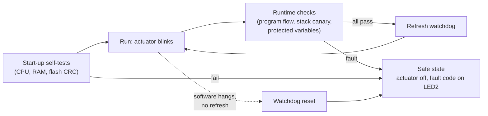
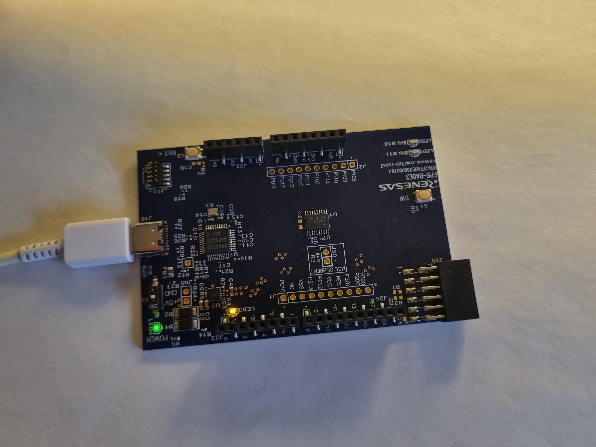
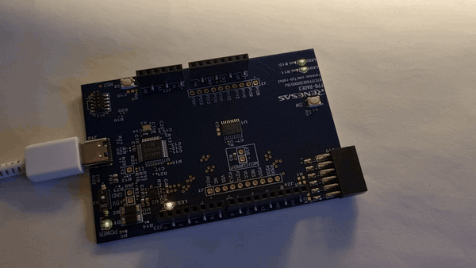

# RA0E3 Safety Monitor

[](https://github.com/Madmaxcoder2612/ra0e3-safety-monitor/actions/workflows/ci.yml)
[](https://en.cppreference.com/w/c/99)
[](LICENSE)
[](#limitations)

A functional safety learning project on the Renesas **FPB-RA0E3** board (Arm Cortex-M23, 32 MHz, 16 KB flash, 2 KB RAM). A blinking "actuator" LED is supervised by safety mechanisms. When a fault is detected, the actuator is switched off and a fault code is shown on the second LED.

The project starts from a hazard in my own words and works towards firmware, one mechanism at a time, each with a test and a failure-mode entry.

> **Not certified.** This is a learning and portfolio project that follows IEC 61508 / IEC 60730 Class B *patterns*. It is not certified, not assessed by any third party, and must not be used in a real safety-related product. Nothing here is claimed to work on hardware until it has been flashed and observed. See [Limitations](#limitations).

## Contents

- [The idea](#the-idea)
- [Status at a glance](#status-at-a-glance)
- [The board](#the-board)
- [Quick start](#quick-start)
- [How it works](#how-it-works)
- [Repository layout](#repository-layout)
- [Limitations](#limitations)
- [Next steps](#next-steps)
- [License](#license)

## The idea

Every safety mechanism exists to answer one hazard: the actuator keeps running although the software has failed. The planned mechanisms and the safe state they lead to:



The watchdog plays the role of the fuse: it trips even when the software that should switch the actuator off is itself hung.

## Status at a glance

Nothing safety-related runs on the board yet, only the stock Blink baseline. The first safety code exists as portable C with host unit tests and is not yet part of the firmware.

| Step | State |
|---|---|
| Board bring-up (stock Blink project, 2 user LEDs, button S1) | done, see [bring-up notes](docs/bringup.md) |
| Hazard analysis | first hazard written, [H-01](docs/hazard_analysis.md) |
| Safety requirements | SR-01 drafted, SR-02 open, [requirements](docs/requirements.md) |
| Peripherals confirmed in the hardware manual (IWDT, CRC, clock monitor) | open |
| First mechanisms: flash CRC check, protected variable, safety core (latched fault, safe state) | written and host-tested (124 checks), see [failure modes](docs/failure_modes.md). Not on the board |
| Watchdog, program flow, stack canary, HAL, fault injection | not started |

## The board

The baseline is the stock Renesas Blink example, running unchanged on my FPB-RA0E3:



*LED1 and LED2 sit at the top right next to the SW button (S1). LED4 is the green power LED.*

The two user LEDs blink in step. LED1 will become the actuator and LED2 the fault indicator:



*Four seconds, looping. The camera was handheld. Full video: [blink_demo.mp4](media/blink_demo.mp4).*

## Quick start

There is no safety firmware on the board yet. Today you can check the documentation and run the host unit tests of the safety code. This needs Python 3.10 or newer and a C compiler (gcc or clang), and installs nothing:

```bash
git clone https://github.com/Madmaxcoder2612/ra0e3-safety-monitor.git
cd ra0e3-safety-monitor
python tools/check_links.py
python tools/run_host_tests.py
```

The second command ends with:

```text
124 checks, 0 failed
```

To run the baseline on the board, open `Blink_Project/` in e2 studio with FSP, build, and flash with the on-board debugger.

## How it works

| File | Role |
|---|---|
| [docs/bringup.md](docs/bringup.md) | What I observed on the board and what is confirmed from the project files |
| [docs/hazard_analysis.md](docs/hazard_analysis.md) | Hazards, safe state, assumptions |
| [docs/requirements.md](docs/requirements.md) | Safety requirements SR-xx |
| [docs/decisions.md](docs/decisions.md) | Decision log: what was decided and why |
| [docs/failure_modes.md](docs/failure_modes.md) | How each mechanism can itself fail, and what is still open |
| [safety/](safety) | Portable C99 safety code (`sm_crc32`, `sm_protected`, `sm_core`) and its host tests |
| [tools/check_links.py](tools/check_links.py) | Checks that every link in the docs resolves, run by CI |
| [tools/run_host_tests.py](tools/run_host_tests.py) | Builds and runs the host unit tests, warnings as errors, run by CI |
| `Blink_Project/` | e2 studio / FSP project. Files in `ra/`, `ra_cfg/` and `ra_gen/` are generated by Renesas FSP and are not edited by hand |

## Repository layout

```text
.
├── Blink_Project/         e2 studio / FSP project (baseline)
├── docs/                  Bring-up notes, hazards, requirements, decisions, failure modes
├── safety/                Portable safety code (include/, src/, test/)
├── media/                 Photo, GIF and video of the board
├── tools/                 Documentation checks (fault injection script comes later)
└── .github/workflows/     CI
```

## Limitations

- **Not certified**, see the notice at the top.
- **Nothing safety-related runs on the board yet.** The mechanisms are tested on a PC only. No claim about detection time, coverage or behaviour on the Cortex-M23 is made.
- **The watchdog, which covers the hang case, is not built.** Until then a hung program would not be stopped.
- **Assumed fault tolerant time.** The 1 s in SR-01 is my assumption, not derived from a real machine.
- **No external hardware cutoff.** There is no breaker or fuse equivalent outside the chip. The on-chip watchdog is the only independent trip mechanism.
- **Peripherals not yet confirmed.** The IWDT and CRC unit are marked available in the FSP files, and no clock monitor was found. All three still need confirming in the RA0E3 hardware manual.
- **Tiny memory.** The usable flash is about 15 KB and RAM is 2 KB, so every mechanism has to be small.

## Next steps

1. Write SR-02 (start-up conditions) and confirm the peripherals in the hardware manual.
2. Add the HAL (LED pins), wire `safety/` into the e2 studio project, then flash and observe.
3. Add the watchdog, program flow monitor and stack canary, each with a host test and a failure-mode entry.
4. Add the fault-injection script and a traceability table, then run the fault injection on the board.

## License

[MIT](LICENSE). The Renesas FSP files keep their own licenses, see the note in the license file.
