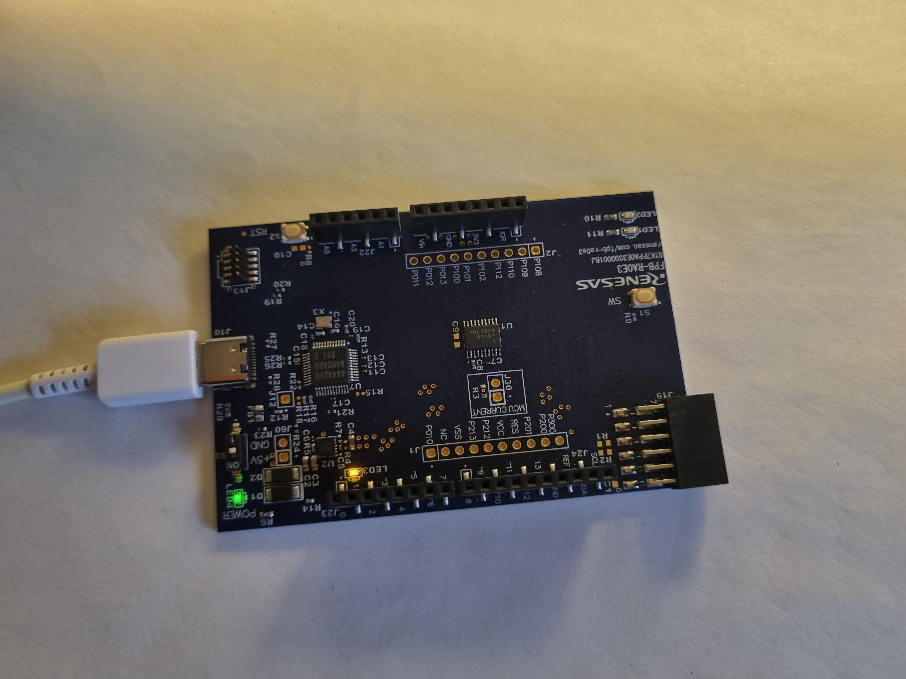

# Board bring-up notes

Stock FSP "Blinky" project for the FPB-RA0E3.

## Observed on the board

- The documentation of the example says it blinks all LEDs. On this board I see **two** LEDs.
- Button: **S1** (user switch).
- Watchdog and clock monitor are not visible on the board or the quick start guide. They are on-chip blocks and must be looked up in the RA0E3 hardware user's manual.

## Confirmed from the project files

| Item | Value | Source |
|---|---|---|
| LED1 | P010 | `Blink_Project/ra/board/ra0e3_fpb/board_leds.c` |
| LED2 | P011 | same file |
| Flash | 16384 bytes | `ra_cfg/fsp_cfg/bsp/bsp_mcu_device_pn_cfg.h` |
| RAM | 2048 bytes | same file |
| Usable flash | 15296 bytes (starts at 0x440) | `Debug/Blink_Project.map` (linker script) |

The stock example blinks every entry of `g_bsp_leds`, and this board defines two, which matches what I see.

## Open, to confirm in the hardware manual

- Which pin S1 uses (P012 or P013 are configured as inputs).
- IWDT: FSP marks it available (own 16.384 kHz clock). Confirm in the manual.
- CRC calculator: FSP marks it available. Confirm in the manual.
- Clock frequency monitor (CAC): not found by me in the manual or FSP feature file. Treat as missing until a search of the manual for "CAC", "Clock Frequency Accuracy" and "oscillation stop" is done.

## Photo and video

- Photo: [media/blink_board.jpg](../media/blink_board.jpg)
- Video: [media/blink_demo.mp4](../media/blink_demo.mp4)

What the photo shows (my reading, to be checked against the board user guide):

- LED1 and LED2: two small LEDs at the top right near the SW button. These are the two LEDs the Blink code drives. Both are off in this frame (off phase of the blink).
- LED3: yellow, lit, near the bottom pin header. Not driven by the Blink code. Possibly an on-board debugger status LED, not confirmed.
- LED4: green, labelled POWER.
- S1 is the button labelled SW. S2 is labelled RST.

This explains the "three LEDs" in the example documentation versus two blinking LEDs: the board has more LEDs, but only two are user LEDs defined in the BSP.
